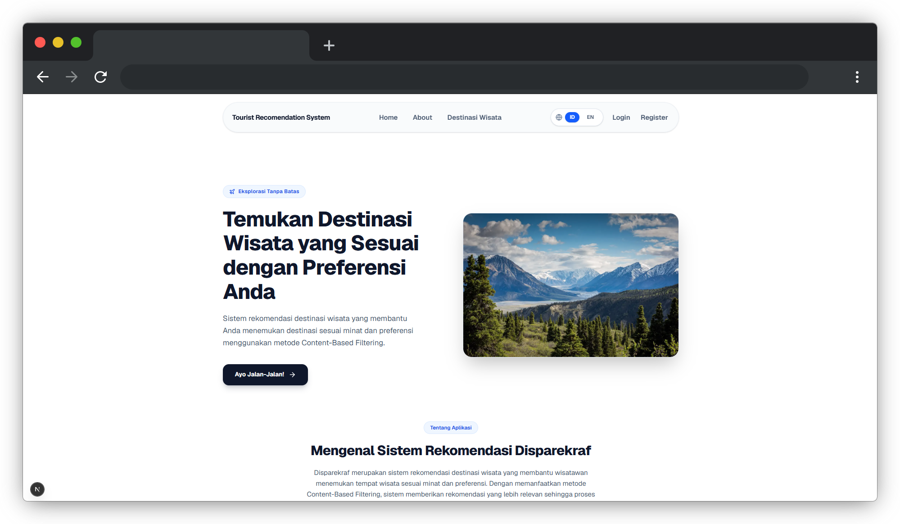
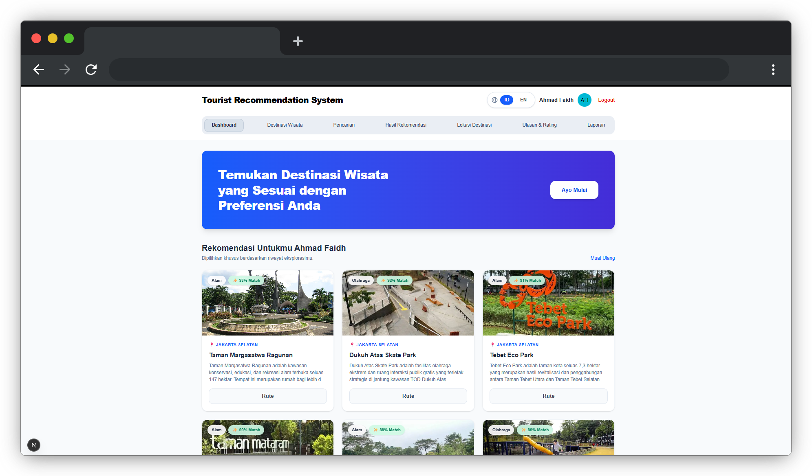
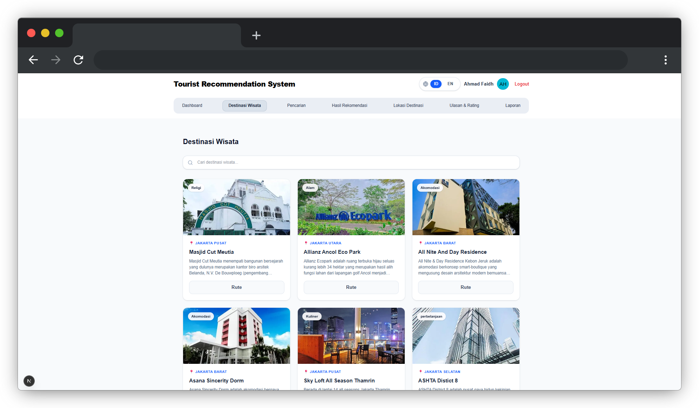
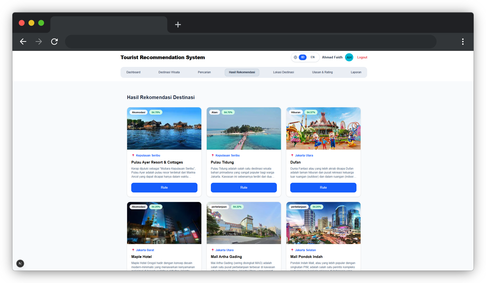
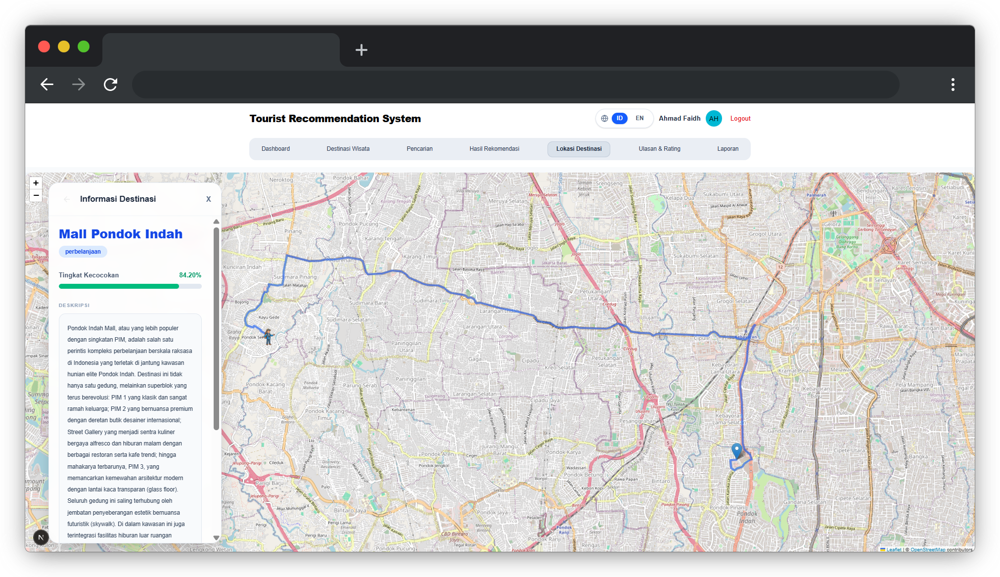
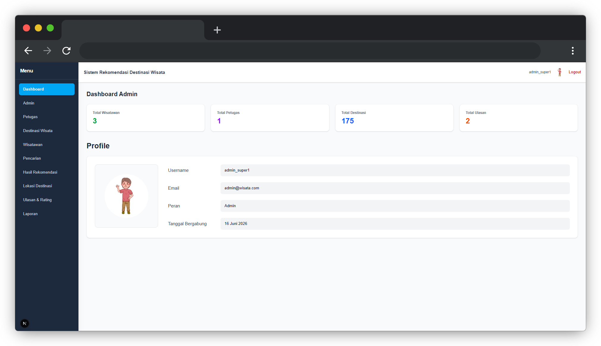

# Tourist Destination Recommendation System

A web-based travel recommendation platform that helps users discover tourism destinations based on their interests and preferences using Content-Based Filtering and Sentence-BERT.


**Built with:** Next.js · Go · FastAPI · PostgreSQL · Sentence Transformers · OpenStreetMap

---

## Application Preview

Explore the main interfaces of the Tourist Destination Recommendation System.

<table>
  <tr>
    <td width="50%">
      
      <p align="center"><strong>Landing Page</strong></p>
    </td>
    <td width="50%">
      
      <p align="center"><strong>Tourist Dashboard</strong></p>
    </td>
  </tr>
  <tr>
    <td width="50%">
      
      <p align="center"><strong>Destination List</strong></p>
    </td>
    <td width="50%">
      
      <p align="center"><strong>Recommendation Page</strong></p>
    </td>
  </tr>
  <tr>
    <td width="50%">
      
      <p align="center"><strong>GIS Page</strong></p>
    </td>
    <td width="50%">
      
      <p align="center"><strong>Admin Dashboard Page</strong></p>
    </td>
  </tr>
</table>

## About The Project

**Tourist Destination Recommendation System** is a web-based travel recommendation platform designed to help users discover tourism destinations based on their interests and preferences.

The application integrates Machine Learning and Geographic Information System (GIS) technologies to provide relevant destination recommendations while presenting geographical information through an interactive map.

### Project Objectives

- Help users discover tourism destinations that match their interests.
- Provide personalized recommendations using Content-Based Filtering.
- Utilize Sentence-BERT to represent textual information for the recommendation process.
- Present destination locations through an interactive map.

### Problem Statement

Finding suitable tourism destinations can be challenging when users have limited information or are unsure where to visit. This application aims to simplify the discovery process by providing recommendations based on destination characteristics and user preferences.

## Key Features

### User Features

- **Personalized Destination Recommendations** — Discover tourism destinations based on user preferences using a Content-Based Filtering approach.
- **Destination Exploration** — Browse available tourism destinations and explore their detailed information.
- **Interactive Map** — View geographical locations of tourism destinations through an interactive map.
- **Destination Details** — Access destination information to help users make informed travel decisions.
- **User Authentication** — Register and log in to access application features.
- **Review & Rate** — Send some review and rate for the place, this data will be use for evaluate the destination.

### Admin Features

- **Dashboard Analytics** — Monitor tourism destination data through a centralized dashboard.
- **Destination Management** — Manage tourism destination information within the application.
- **Data Visualization** — View statistical information through charts and visual representations.
- **User data management** — Manage Tourist Account within the application.
- **Review & Rate Report** — Download review and rate data a destination.
- **Statistical Report** — Download statistical report such "how many user visiting a destination etc.".

## Technology Stack

### Frontend


### Backend


### Machine Learning & Recommendation Service


### Database & Infrastructure


### Third-Party Services & Libraries


## Installation & Setup

Follow the instructions below to run the project locally.

### Prerequisites

Make sure you have installed the following tools:

- [Git](https://git-scm.com/)
- [Docker](https://www.docker.com/)
- [Docker Compose](https://docs.docker.com/compose/)

### 1. Clone Repository

```bash
git clone https://github.com/vion-15/Sistem-Rekomendasi-DestinasiWisata.git

cd Sistem-Rekomendasi-DestinasiWisata
```

### 2. Environment Configuration

Create the required environment files based on the provided `.env.example` files.

```bash
cp .env.example .env
```

Update the environment variables according to your local configuration.

**Note:** Make sure all required environment variables are properly configured before starting the application.

### 3. Run Application

Build and start all application services using Docker Compose:

```bash
docker compose up --build -d
```

Check the running containers:

```bash
docker compose ps
```

### 4. Stop Application

To stop all running services:

```bash
docker compose down
```

### Additional Notes

- Make sure Docker Desktop is running before executing Docker Compose commands.
- Configure the required environment variables before starting the application.
- Application access URLs and ports depend on the Docker Compose configuration.

## Author

**Developed by [Ahmad](https://github.com/vion-15)**

Computer Science Graduate | Junior Software Developer

- GitHub: [@vion-15](https://github.com/vion-15)